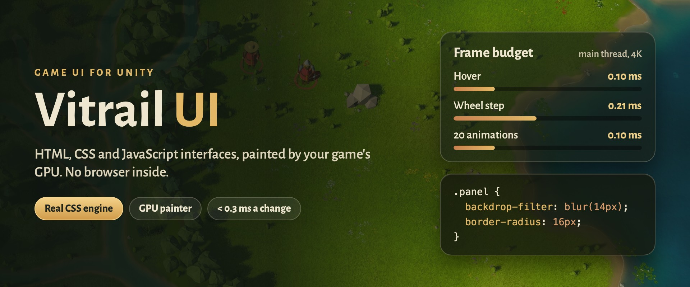
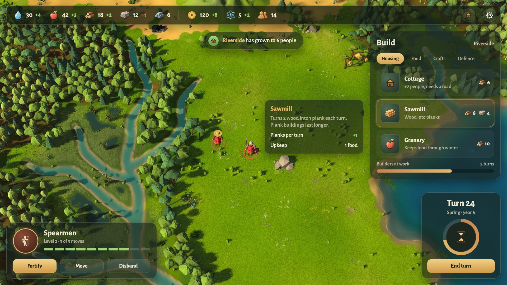
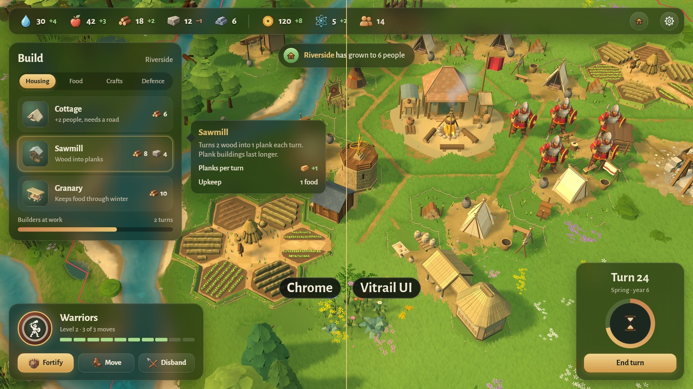
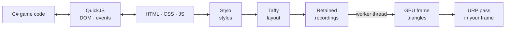

<div align="center">




[](https://ko-fi.com/yaroslavkostiuk)

**HTML, CSS and JavaScript UI for Unity games, rendered by your game's GPU. No browser, no web view.**

[Getting started](docs/getting-started.md) · [CSS support](docs/css-support.md) · [Performance](docs/performance.md) · [Architecture](docs/architecture.md)

</div>

---

Write your menus, HUDs and inventories the way the web is written: HTML for structure, CSS for looks, JavaScript or C#
for behaviour. Vitrail UI lays them out with Firefox's CSS engine and paints them with its own GPU renderer inside your
frame, so a hover or a changed number costs a fraction of a millisecond.

It is an open alternative to Unity UI Toolkit, uGUI and embedded browsers such as Coherent Gameface or Chromium-based
web views: real CSS (flexbox, grid, gradients, shadows, `backdrop-filter` glass), but no browser process, no extra
memory for one, and no per-title fees. Free to use in commercial games.



<p align="center"><sub>Every panel above is plain HTML and CSS: glass (<code>backdrop-filter</code>), gradients, shadows, grid, a conic ring. Painted by Vitrail UI itself (<a href="media/src/showcase.html">source</a>).</sub></p>

## Why Vitrail UI

| | Vitrail UI | Unity UI Toolkit | uGUI |
|---|:---:|:---:|:---:|
| Standard HTML and CSS (selectors, cascade, variables, `calc()`) | ✅ | subset (USS) | — |
| Flexbox and grid | ✅ | flexbox | layout groups |
| Gradients, box shadows, `filter`, `mix-blend-mode` | ✅ | — | — |
| Glass: `backdrop-filter` blur over the game scene | ✅ | — | — |
| CSS transitions and `@keyframes` | ✅ | transitions | — |
| JavaScript, ES modules, Preact and petite-vue | ✅ | — | — |
| Preview and edit pages in any browser | ✅ | — | — |
| Gamepad navigation, IME text input | ✅ | ✅ | ✅ |

## Features

**Rendering**
- CSS from Firefox (Stylo through [Blitz](https://github.com/DioxusLabs/blitz)), layout by Taffy, text by Parley.
- A GPU painter in a URP pass: analytic antialiasing, a glyph atlas, colour emoji, SVG, rounded clips, masks,
  `clip-path`, filters and glass.
- Unity textures inside pages: `` shows a RenderTexture without a copy.
- Test pages match Chrome within 1/255 on average.

**Speed**
- Retained painting: each element keeps its recording, only what changed is painted again.
- Styles and layout on the main thread, the frame built on a worker; the last frame stays until the next is ready.
- Transform and opacity animations move on the GPU without repainting; lists scroll on the GPU.

**Scripting and data**
- QuickJS with a DOM: events, timers, `requestAnimationFrame`, modules, `fetch` of local files, `MutationObserver`,
  Web Animations, drag and drop.
- `engine.on` / `engine.trigger` between JavaScript and C#.
- `data-bind-*` attributes show C# models with no script at all.

**Input and tools**
- Mouse, smooth wheel, overlay scrollbars, keyboard, text fields with selection, clipboard and IME.
- `<select>` with a list you style in CSS; gamepad (spatial) navigation with `:focus-visible`.
- Pages on the screen or on a surface in the world.
- An inspector in the editor: element tree, boxes, computed styles editable live, picking over the game.
- Hot reload: save a page and it updates in Play mode.

## As close to Chrome as it gets



<p align="center"><sub>The same HTML and CSS: left of the line headless Chrome, right of it Vitrail UI. The test suite compares
every test page with Chrome pixel by pixel; most differ by less than 1/255 on average.</sub></p>

## How it works



Only changed elements are recorded again; the frame is built off the main thread and drawn in a single pass with
your scene. Details: [Architecture](docs/architecture.md).

## Performance

Apple M4, a game top bar at 4K unless noted. The test suite enforces these budgets.

| Main-thread cost | |
|---|---|
| A change (text, class, hover) on any page | **< 0.3 ms** |
| Hover on a 4K window of 100 cards | **≈ 0.1 ms** |
| A wheel step in a 2000-cell list (mean) | **0.21 ms** |
| 20 transform/opacity animations, per frame | **0.1 ms** |

Details and method: [docs/performance.md](docs/performance.md).

## Quick start

1. **Window › Package Manager › + › Add package from git URL:**
   `https://github.com/Yarik0378/Vitrail-UI.git?path=/package`
   (Unity 6 with URP and the Input System; libraries for macOS and Windows are included.)
2. Put a page under `Assets/StreamingAssets/ui/menu.html`.
3. **GameObject › UI › Vitrail UI Screen**, pick the page, press Play.

```html
<div class="bar">
  <span id="gold">0</span>
  <button data-action="end-turn">End turn</button>
</div>
```

```csharp
using Vitrail;

var ui = GetComponent<VitrailScreen>().Panel;
ui.SetText("#gold", "120");                        // by CSS selector
ui.Clicked += (action, id) => Debug.Log(action);    // "end-turn"
ui.SetModel("player", JsonUtility.ToJson(player));  // data-bind-value="{{player.gold}}"
ui.Triggered += (name, json) => { };                // engine.trigger(...) in the page
```

Four samples come with the package: a main menu, a HUD bound to a C# model, an inventory with drag and drop, and a
panel in the world.

## Documentation

| | |
|---|---|
| [Getting started](docs/getting-started.md) | Pages in a game, talking to them from C# and JavaScript |
| [CSS support](docs/css-support.md) | What works, how close to Chrome, what doesn't yet |
| [Architecture](docs/architecture.md) | How a page becomes pixels |
| [C API](docs/c-api.md) | The native library, for other engines |
| [Performance](docs/performance.md) | Costs, budgets, how to measure |
| [Maintaining](docs/maintaining.md) | Building, the patches on Blitz and anyrender, the test suite |

## Roadmap

- [x] GPU rendering, animations, JavaScript, input, Unity package, inspector, CI
- [ ] Built-in and HDRP pipelines
- [ ] `<select multiple>`, 3D transforms, network URLs
- [ ] Godot and Unreal on the same core

## Status

Version 0.1.0, an early release: everything above works and is covered by tests, but expect rough edges and API
changes before 1.0. Linux builds come from CI and the source (`native/build.sh`); a prebuilt Linux library will
follow.

Bug reports, test pages that render differently from Chrome, and pull requests are welcome in
[Issues](https://github.com/Yarik0378/Vitrail-UI/issues).

If Vitrail UI saves you time, [buy me a coffee](https://ko-fi.com/yaroslavkostiuk) ☕. It helps keep it free.

## License

Free, including for games you sell.

- **Yes:** use Vitrail UI in any free or paid game or application and sell it on Steam, consoles, mobile stores or
  anywhere else. No fee, no royalty, no permission needed.
- **Yes:** change it, improve it and share it for free.
- **No:** sell Vitrail UI itself, a changed copy of it, or an asset or library built mainly from it.

Terms: [MIT with the Commons Clause](LICENSE.md). © 2026 Yaroslav Kostiuk.

Third-party components keep their own licenses: [Third Party Notices](package/Third%20Party%20Notices.md).
